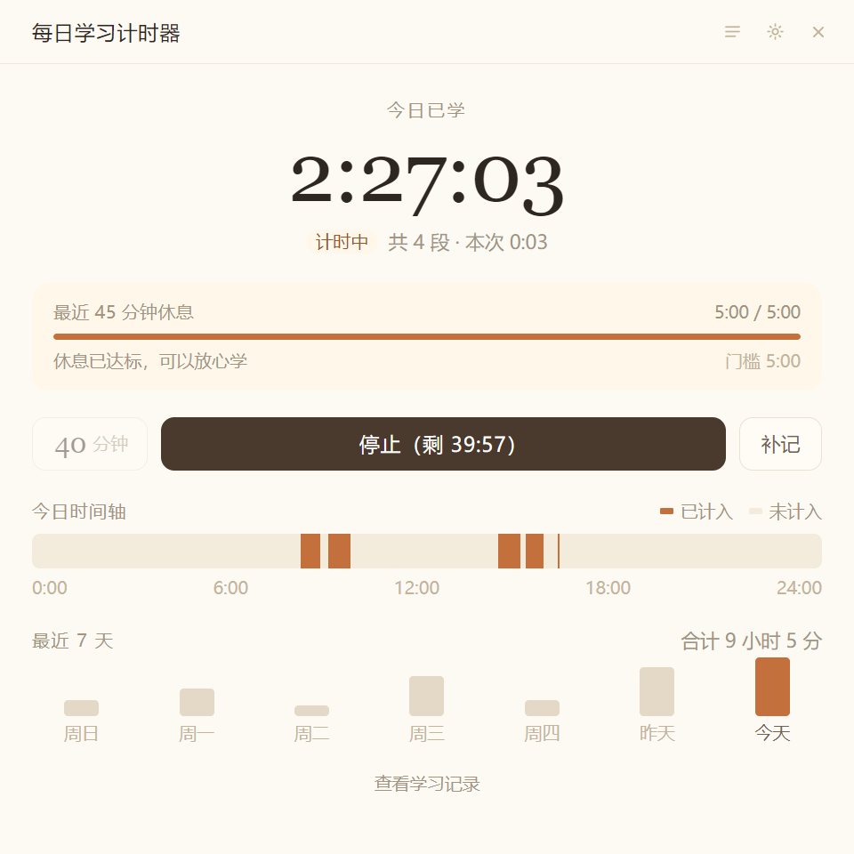
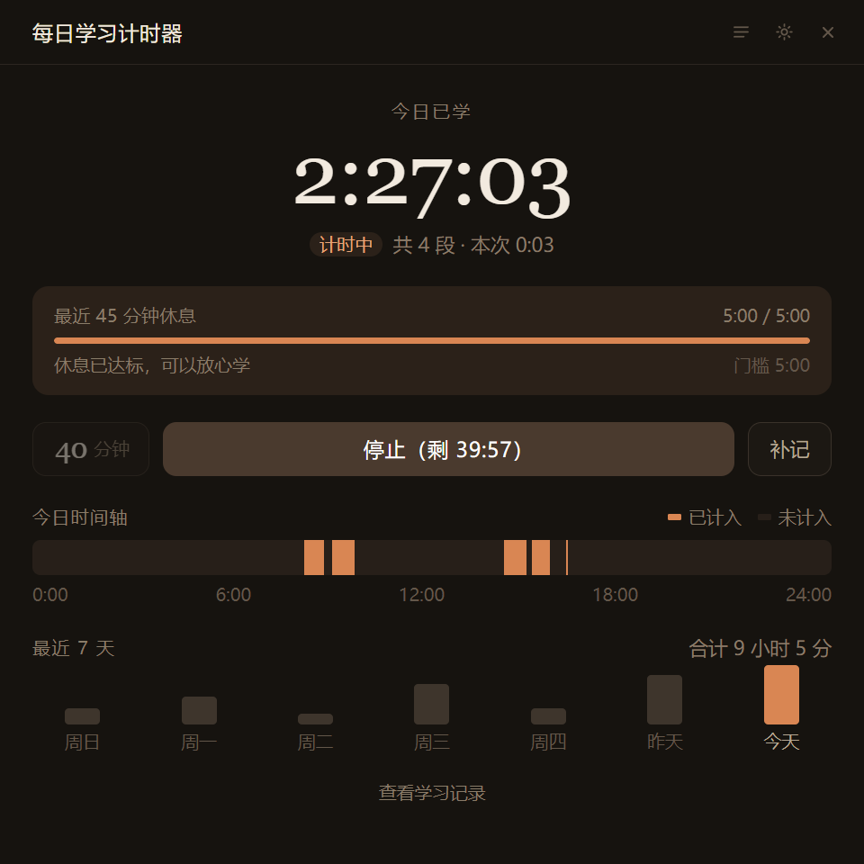
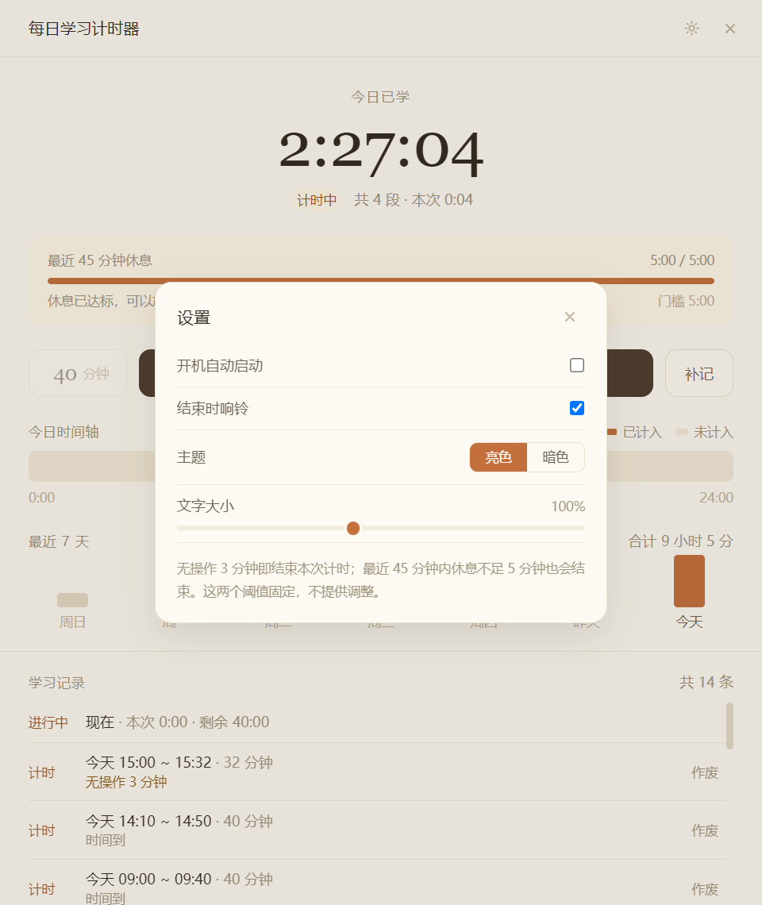
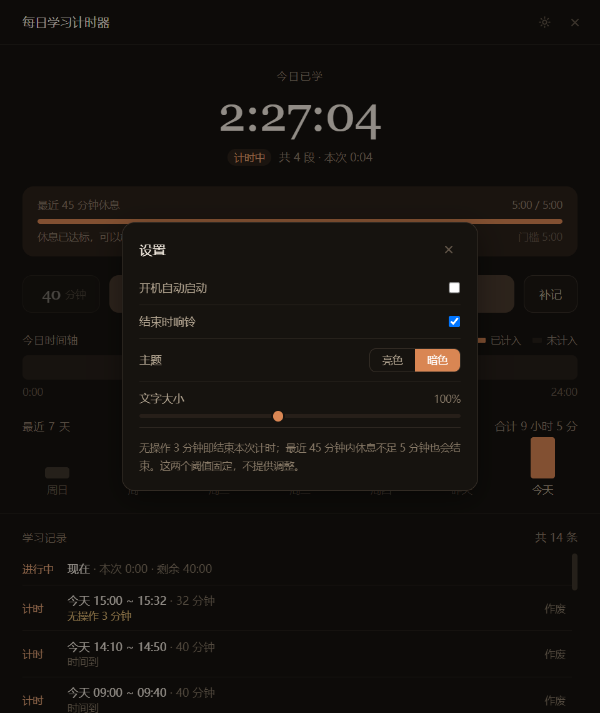
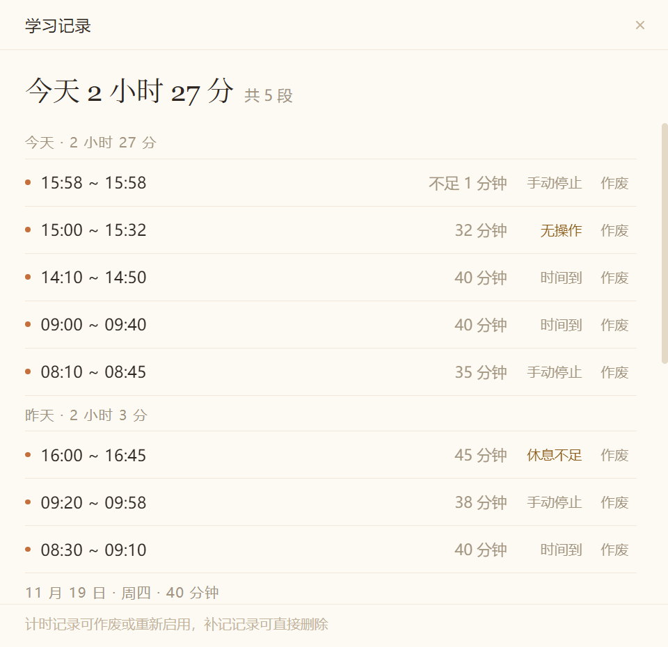
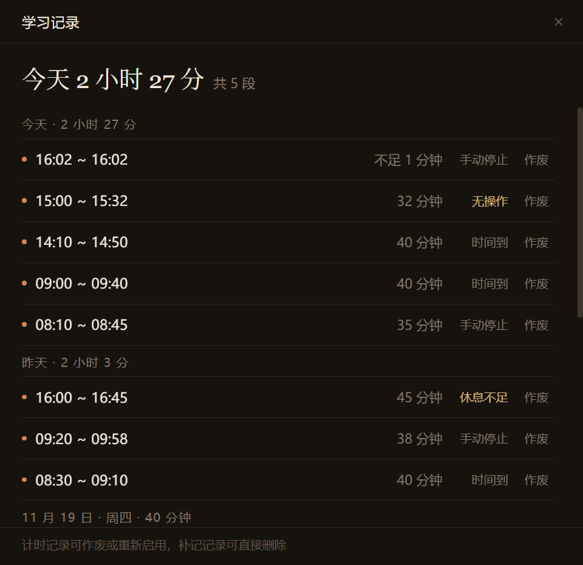

# 每日学习计时器

Windows 桌面学习计时器。屏幕角落常驻一个胶囊浮窗，随时能看到今天学了多久、现在是否在计时；点开是完整的面板，有今日时间轴、最近 7 天走势和学习记录。



[产品主页](https://u32-cn.github.io/time-tracker/) · [下载最新版](https://github.com/u32-cn/time-tracker/releases)

网页版（`kid.u32.cn/time-tracker`）的短板是检测不到系统级状态——锁屏了、电脑睡了、人走了，它照样在倒计时。桌面版把这三件事补上，并坚持一条原则：**宁可少记，不多记。**

## 适用场景

这个工具最初是作者给自己小孩做学习时间统计的，统计对象是**电脑上的学习时间**——学英语、学编程这类会频繁敲键盘、动鼠标的活动。

- 计时必须手动点开始，但只要离开电脑 3 分钟不操作，就自动结束，不需要人记得去停。
- 看视频这类不碰键鼠的场景，2 分 30 秒会有预警提醒，动一下鼠标就自动继续计时。
- 正因为「无操作即停止」，它**不适合记录电脑外的学习时间**——比如看纸质书、写作业，否则就得每 3 分钟晃一下鼠标来续计时，显然不合适。

## 特性

- **锁屏、睡眠自动结束**，人不在就不算学习
- **无操作 3 分钟自动结束**，2 分 30 秒时先预警，只算到最后一次操作 + 3 分钟
- **45 分钟滑动窗口管休息**，学满 40 分钟必须歇 5 分钟
- **亮色 / 暗色主题**一键切换，暗色是暖纸的夜间版，不是纯黑
- **文字大小可调**，80%–160% 滑动调节，默认 120%，浮窗会跟着缩放
- 桌面胶囊浮窗 + 托盘常驻，开机自启可选
- 结束响铃 10 秒 + 置顶弹窗

## 计时规则

只有两个状态：**没在计时 / 正在计时**。没有暂停，结束就是结束，要学重新点开始。

### 记账铁律

> 任何一段学习时长，最多算到「最后一次键鼠操作 + 3 分钟」，再往后一律不计。

每 5 秒采样一次系统空闲时长。这一条同时覆盖了人走开、看视频不碰鼠标、锁屏、睡眠、断电、进程被杀——凡是没法确认你在的情况，一律不算。停电重启后按最后一次落盘结算。

### 五种结束条件

| 触发 | 判定 | 计入到 | 提示 |
|---|---|---|---|
| 目标到点 | 你要的 1–40 分钟走完 | 到点那一刻 | 响铃 + 弹窗 |
| 休息不足 | 最近 45 分钟内学习超过 40 分钟 | 违规那一刻 | 响铃 + 弹窗 |
| 无操作 | 连续 3 分钟没有键鼠操作即结束；2 分 30 秒时先预警一次 | **最后一次操作 + 3 分钟** | 150 秒预警弹窗（不响铃）；180 秒响铃 + 弹窗 |
| 锁屏 / 睡眠 | 系统事件 | 事件那一刻 | 静默，浮窗标注 |
| 手动停止 | 点停止按钮 | 点击那一刻 | 静默 |

### 休息规则

不是"连续学 40 分钟"，是**滑动窗口**：任意时刻往前看 45 分钟，其中必须有 5 分钟不是在学。

```
违规条件：最近 2700 秒内累计学习 > 2400 秒
等价于：  最近 45 分钟内休息不足 5 分钟
```

所以"学 39 分、歇 1 分、再学 39 分"这种绕法走不通——第二个 39 分钟还没学完就会被拦。

开始前面板会显示还能学多久；不足 1 分钟时开始按钮直接禁用，并倒计时还需休息多久。

`180`（无操作阈值）、`150`（预警提前量）、`300`（最低休息）、`2700`（窗口长度）都是常量，不开放设置。这些阈值是规则不是偏好，能调就容易自欺。

## 界面

| 亮色浮窗 | 暗色浮窗 |
|---|---|
|  |  |

浮窗显示倒计时、今日累计、状态点（计时中=陶土橙，快到 3 分钟=琥珀，未开始=灰）。可拖动，单击展开主面板，右键同样展开，右侧小方块直接停止。

暗色主题：



设置面板可以切主题、拖文字大小。默认 120%，滑条正中是 120%，往左能小到 80%，往右最大 160%，浮窗尺寸会跟着一起缩放：

| 亮色设置 | 暗色设置 |
|---|---|
|  |  |

学习记录单独一个窗口，按天分组，每组带当天总时长。点主面板右上角的三条横线图标，或底部「查看学习记录」打开：

| 亮色记录 | 暗色记录 |
|---|---|
|  |  |

计时记录可以作废或重新启用，补记记录可以直接删除。作废的记录仍留在列表里但变灰，统计不计入。

无操作 2 分 30 秒时先弹出预警（置顶、不响铃），浮窗倒计时切换为「距自动结束还剩多少秒」。预警期内动了鼠标，预警自动消失、计时无缝继续；3 分钟整仍无操作则响铃结束。预警不是宽限：结束线始终是最后一次操作 + 3 分钟，晃动必须在结束前发生才有效。

自动结束时会弹出置顶提醒并响铃 10 秒。动一下鼠标它自己就消失：


## 安装

从 [Releases](https://github.com/u32-cn/time-tracker/releases) 下载 `time-tracker-setup-x.y.z.exe`，双击安装。

安装包未签名，Windows SmartScreen 首次运行会提示"已保护你的电脑"，点「更多信息 → 仍要运行」即可。

免安装版在 `win-unpacked` 目录，解压后直接运行 `time-tracker.exe`。

## 数据

存在 `%APPDATA%\每日学习计时器\data.json`，原子写入（临时文件 + rename）。

```json
{
  "id": "abc123",
  "startTs": 1763700000000,
  "endTs": 1763702400000,
  "dayStartTs": 1763654400000,
  "seconds": 1980,
  "segments": [[1763700000000, 1763701380000]],
  "targetSec": 2400,
  "source": "timer",
  "status": "active",
  "endReason": "idle"
}
```

`segments` 是实际计入的连续区间，时间轴按它画，所以中间被剔除的空洞看得见。`endReason` 取值 `target` / `rest` / `idle` / `lock` / `sleep` / `manual` / `crash`。

全量历史都留着，不像网页版滚动删除 7 天。统计图仍只画 7 天。

从旧版本升级时，会自动把 `%APPDATA%\时间管理\data.json` 复制过来，不会丢记录。

## 开发

```bash
npm install
npm start          # 启动（走 scripts/dev.js）
npm test           # 计时内核单元测试，9 个用例
npm run icon       # 重新生成 build/icon.ico
npm run dist       # 打包 NSIS 安装包 → dist/
```

`npm test` 覆盖 9 个用例：目标到点、2 分 30 秒预警与 3 分钟截断、预警后恢复操作、45 分钟窗口拦截、启动前预检、超额目标拒绝并返回额度、崩溃恢复不多记、跨零点归属、补记与已有记录时间重叠拒绝。

本机若注入了 `NODE_OPTIONS` 或 `ELECTRON_RUN_AS_NODE`，打包需要绕开：

```bash
env -u NODE_OPTIONS -u ELECTRON_RUN_AS_NODE npm run dist
```

前者会让 electron-builder 的清理操作被安全删除钩子拦住，后者会让 Electron 退化成纯 Node 直接崩。

想看看有数据长什么样，可以灌一份演示数据（会覆盖当前 `data.json`）：

```bash
node scripts/seed-demo.js           # 写入一周示例
node scripts/seed-demo.js --clean   # 删掉
```

### 结构

```
src/main/       主进程
  index.js        窗口、托盘、IPC、弹窗、旧数据迁移
  tracker.js      计时内核（记账、五种结束条件、休息窗口）
  store.js        JSON 持久化
  time.js         时间工具
src/preload/    contextBridge 桥接，渲染层不碰 Node
src/renderer/
  float/          浮窗胶囊
  panel/          主面板与设置
  notice/         结束弹窗（含钟声合成）
  shared/         设计变量（亮/暗两套）
scripts/        dev 启动器、图标生成、演示数据
test/           tracker 单元测试
build/          图标资源
```

计时逻辑全在主进程，渲染层只负责画。`powerMonitor.getSystemIdleTime()` 只有主进程能用，这也是为什么架构必须这么切。

## 已知取舍

- **看视频、读书不碰键鼠，从第 4 分钟起不计时。** 这是"无操作即不算"的直接后果，不是 bug。真要支持得给特定程序开白名单，那是另一套复杂度，目前不做。
- **浮窗用 `floating` 层级置顶**，全屏游戏和全屏视频可能盖住它。这是故意的，不挡你看片。
- **Electron 常驻内存 120–180MB**，对一个小工具偏重。换来的是锁屏/睡眠/空闲三件套开箱即用，不用写 native 模块。
- **安装包未签名。**

## License

MIT
